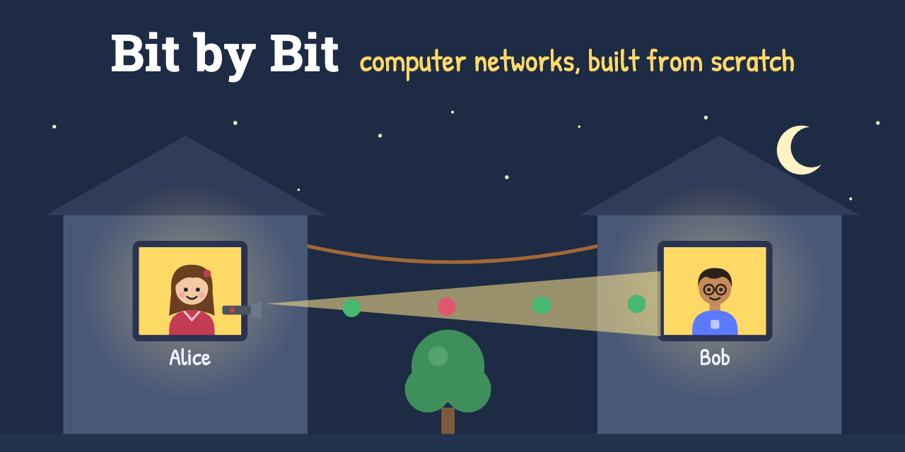

# Bit by Bit: computer networks, built from scratch

**Read it online: <https://mohsinkaleem.github.io/bit-by-bit-networks/>**



A free book about how computer networks work, told as a story, by Mohsin Kaleem. Alice and Bob start with a flashlight
between their bedroom windows, and one problem at a time they invent everything a network needs: codes, wires,
turn-taking, frames, addresses, switches, packets, routers, ports, reliable connections and names. Then the book takes
the real protocols apart, from Ethernet and Wi-Fi to TLS 1.3, QUIC and BGP, and ends with where networking is heading.
Every chapter has diagrams, interactive figures, and a hands-on Python lab.

The style is inspired by [Computer Networks From Scratch](https://www.networksfromscratch.com/) by Seth Archer Brown.

## What's inside

- **Part I, Networks as They Might Have Been** (chapters 1–15): invent a network from nothing, from flashlight codes to switches, routers, TCP and DNS.
- **Part II, Networks as They Are** (chapters 16–38): packet capture, the physical layer, Ethernet, Wi-Fi,
  IPv4, ARP and ICMP, DHCP and NAT, routing with OSPF, BGP, IPv6, UDP and sockets, TCP, congestion control, DNS,
  real-world HTTP, cryptography, TLS 1.3, HTTP/2 and HTTP/3 over QUIC, proxies, CDNs and firewalls, VPNs and tunnels,
  container networking, a whole page load end to end, and troubleshooting.
- **Part III, Networks as They May Be** (chapters 39–44): programmable networks (SDN, P4 and eBPF),
  satellite internet, delay-tolerant networking for Mars, post-quantum cryptography, named-data networking, and
  mesh networks, 5G and the edge. An **epilogue** ends the story and suggests where to go next.
- The **Command-Line Field Guide** collects real networking commands for macOS and
  Linux, with annotated output. Each chapter links to the commands that go with it.

## Doing the labs

Every lab is in `labs/chNN/`. They need Python 3.9 or newer and nothing else: only the standard library. Run
them from their own folder, for example:

```bash
cd labs/ch10
python3 checks.py demo "HI BOB"
```

| Ch. | Lab | What it does |
|----:|-----|--------------|
| 1 | `codebook.py` | encode and decode the 5-bit alphabet, and flash messages |
| 2 | `wire.py`, `live_wire.py` | simulate voltages on a wire: clock drift, Manchester encoding, noise |
| 3 | `framing.py`, `chatterbox.py` | frames with escaping; a half-duplex chat with acknowledgments and retries |
| 4 | `computer.py` | two "computers" with an operating system mailroom, talking over TCP |
| 5 | `bytes_lab.py`, `pixels.py`, `bytewire.py` | bytes, hex and endianness; write a real PNG; length-prefixed messages |
| 6 | `webserver.py`, `browser.py` | a tiny web server and text-mode browser (also works with a real browser) |
| 7 | `dynserver.py` | dynamic pages, forms, cookies and chunked replies over raw HTTP |
| 8 | `bus_sim.py`, `shared_wire.py` | shared-cable collisions (ALOHA, CSMA, CSMA/CD); a UDP "hub" |
| 9 | `switch_sim.py` | learning switches, broadcast storms and spanning tree |
| 10 | `checks.py`, `packets.py` | parity, checksums, CRC-32 and Hamming codes; packets over a noisy line |
| 11 | `routing_sim.py` | routers sharing tables, cut cables, routing loops and traceroute |
| 12 | `otto.py`, `dgram.py` | real UDP ports: chat, chess and a clock; datagrams lost for real |
| 13 | `reliable.py` | reliable delivery over a lossy link: stop-and-wait, go-back-N, selective repeat |
| 14 | `names.py`, `lookup.py`, `eve.py` | a name-server hierarchy with a caching resolver, and cache poisoning |
| 15 | `make_sample.py`, `peel.py` | build a packet capture, and decode it layer by layer |
| 16 | `minidump.py` | a tiny tcpdump: compiles capture filters to a BPF-style program and runs it (sample: `home.pcap`) |
| 17 | `lightspeed.py`, `signals.py` | the speed-of-light limit vs real pings; levels, constellations and noise; your own Wi-Fi's SNR |
| 18 | `frames.py` | real Ethernet frames with CRC and VLAN tags; MAC addresses taken apart; a VLAN-aware switch |
| 19 | `wifi_sim.py`, `air.py` | CSMA/CA with crowds, hidden and slow stations; decoding raw 802.11 frames |
| 20 | `ipcalc.py`, `fragment.py` | subnets from bit operations; IP headers, fragmentation and reassembly (sample: `frag.pcap`) |
| 21 | `pyping.py`, `pytrace.py`, `arpwatch.py` | ping and traceroute from scratch, with no `sudo`; watching the ARP cache for spoofing |
| 22 | `dhcp.py`, `nat_sim.py`, `stun.py`, `mdns.py` | DHCP both ways, a NAT simulation, your real NAT via STUN, and `.local` names |
| 23 | `lpm.py`, `linkstate.py`, `ospf_box.sh` | longest-prefix match with a trie; flooding and Dijkstra, and a real OSPF capture decoded; three real OSPF routers (Linux) |
| 24 | `bgp_sim.py`, `asinfo.py`, `bgp_speaker.py`, `bgp_box.sh` | ten autonomous systems with real business rules, hijacks and RPKI; the real internet's routes from RIPE; a BGP session by hand; five real BIRD routers (Linux) |
| 25 | `v6.py`, `neighbours.py` | IPv6 addresses taken apart and built from MAC addresses; find every IPv6 device on your network |
| 26 | `ntp.py`, `udp_lab.py` | ask real time servers (and run a wrong one); UDP's limits: refused ports, full buffers, datagram sizes, multicast chat |
| 27 | `tcpflow.py`, `tcp_lab.py` | explain every segment of a real TCP capture (sample: `example-org.pcap`); connection states, resets and streams |
| 28 | `cwnd.py`, `bloat.py`, `ccsim.py` | watch a real upload's congestion window; measure bufferbloat; simulate Reno, CUBIC and BBR |
| 29 | `dnswire.py`, `dig.py`, `resolver.py` | DNS messages byte by byte; a tiny dig (UDP, TCP and DNS over HTTPS); a resolver that starts from the root |
| 30 | `httpclient.py`, `cacheproxy.py`, `api.py` | HTTP/1.1 by hand: keep-alive, caching, redirects, ranges, gzip; a caching proxy; JSON APIs |
| 31 | `crypto_lab.py`, `x25519.py`, `chacha.py` | one-time pads, hashes, MACs, Diffie–Hellman, RSA and certificates; X25519 and ChaCha20-Poly1305 checked against the standards |
| 32 | `tls13.py`, `certs.py` | a TLS 1.3 client from scratch that fetches real pages; certificates and RSA, ECDSA and Ed25519 signatures in pure Python |
| 33 | `hpack.py`, `h2client.py`, `aesgcm.py`, `quic.py` | HTTP/2 frames and header compression by hand; AES-GCM; a QUIC and HTTP/3 client that talks to real servers |
| 34 | `balancer.py`, `proxy.py`, `firewall.py`, `anycast.py`, `fw_box.sh` | a load balancer (and its 502s and 504s); a forward proxy; stateless vs stateful firewalls; which root server answers you; nftables (Linux) |
| 35 | `wg_peer.py`, `wg_box.sh`, `tunnel_box.sh` | a WireGuard peer in Python that talks to Linux's own WireGuard; GRE and VXLAN tunnels you can watch (Linux) |
| 36 | `box.sh`, `nsdemo.py` | container networking by hand: namespaces, veth cables, a bridge, NAT and published ports (Linux) |
| 37 | `pressenter.py` | fetch a page one layer at a time (DNS, TCP, TLS, HTTP/2), and draw a waterfall of where the time went |
| 38 | `netdoctor.py`, `breakit.sh`, `dnstrace.py` | a network doctor that checks layer by layer; five broken networks to diagnose (Linux); a traceroute made of DNS questions |
| 39 | `controller.py`, `sdn_box.sh`, `ebpf.py` | an OpenFlow controller that runs Open vSwitch switches (Linux); eBPF programs assembled by hand and loaded into the kernel: counting, dropping pings with XDP, and the verifier saying no |
| 40 | `sky.py` | every Starlink (or OneWeb, or geostationary) satellite's position right now, from real orbit data; how far, how long light takes, and how often the dish must switch |
| 41 | `mars.py`, `dtn.py`, `mars_link.sh` | how far Mars is on any day; real Bundle Protocol (RFC 9171) bundles in CBOR, carried Earth → orbiter → rover by a contact plan; a link as slow as Mars's, where TCP gives up (Linux) |
| 42 | `mlkem.py`, `pqtls.py` | ML-KEM-768 from scratch (FIPS 203), checked against OpenSSL; Chapter 32's TLS client with post-quantum X25519MLKEM768, against real sites |
| 43 | `ndn.py` | named-data networking in the real NDN packet format: ask the worldwide NDN testbed for data by name; an NDN router with a content store and pending interest table |
| 44 | `mesh.sh` | a five-house batman-adv mesh network (Linux): link-quality routing, and healing around a broken radio |

Some labs run servers on ports 7000–7200 on `127.0.0.1`, so they're only reachable from your own computer.
Several Part II labs use the real internet (RIPE's route collectors, public time and DNS servers, Cloudflare's speed test,
a weather API); chapter 28's `cwnd.py` and `bloat.py` upload and download as fast as they can for a few seconds.
A few Part II labs have optional steps that need `sudo` or Linux (live capture, raw frames, a real DHCP
discover), and the `.sh` labs in chapters 23–24 and 34–44 build their networks in Linux network namespaces (a Raspberry Pi is
ideal); each one says so. Chapters 23 and 24's need BIRD (`bird2`). Chapter 35's `wg_box.sh` needs `wireguard-tools`, and chapter 34's `fw_box.sh` shows more with
`conntrack` installed. Chapter 39's `sdn_box.sh` needs Open vSwitch, chapter 44's `mesh.sh` needs `batctl`, and chapter
39's `ebpf.py` needs a recent Linux kernel. Chapters 40 and 43 talk to real services on the internet (CelesTrak's orbit
data, which `sky.py` downloads at most every two hours, and the NDN research testbed). Chapters 31–33 and 42 check their
homemade cryptography against the official test vectors or OpenSSL; it's for learning, not for protecting anything.

## Reading it offline

Clone the repository, build the site and serve it locally:

```bash
python3 build.py
python3 -m http.server 8765 --directory site
```

Then open <http://localhost:8765>.

## Changing it

The site is generated by `build.py` from the sources in `src/` (Python 3, standard library only; the published site is built with 3.14):

```bash
python3 build.py           # rebuild site/
python3 build.py --watch   # rebuild whenever something changes
```

- `src/chapters/NN.html` and `src/epilogue.html`: the chapters, in HTML plus a few shorthand tags (`<terminal>`, `<lab>`,
  `<realworld>`, `<!-- @code labs/...#region -->` and more; see the top of `build.py`).
- `src/figs/chNN.py`: the diagram generators. Run one (`python3 src/figs/ch10.py`) to regenerate that chapter's
  SVG figures, which the chapters include.
- `src/field-guide.html`: the Command-Line Field Guide. Each `<cmd ch="…">` entry also appears in the
  "At the command line" box of the chapters it lists.
- `src/sprites.svg`: shared drawings (people, computers, switches, routers…).
- `assets/main.css` and `assets/widgets.js`: styles and the interactive figures.
- `src/captures/`: a real capture kept for reference (not published on the site).

The build checks every link and anchor, and fails if any are broken. `site/` isn't committed: every push to `main`
runs `.github/workflows/pages.yml`, which builds the site and publishes it to GitHub Pages.

## Corrections and ideas

Found a mistake, or a lab that doesn't run on your machine? Please
[open an issue](https://github.com/mohsinkaleem/bit-by-bit-networks/issues). Pull requests are welcome too.

## License

© 2026 Mohsin Kaleem. The text and figures are under [CC BY 4.0](LICENSE-CONTENT.md): share and adapt them freely,
with credit. The code (labs, figure generators, build script, CSS and JavaScript) is under the [MIT license](LICENSE).
